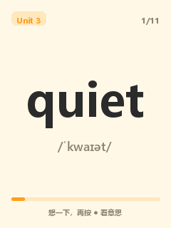
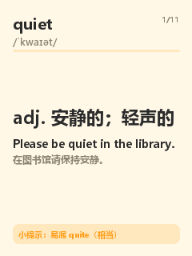
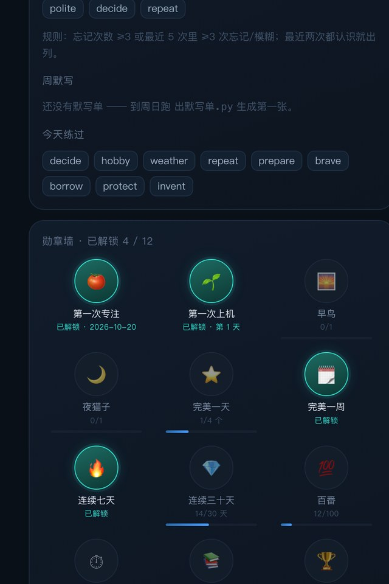

# AI Passport · 一台安静背单词的小机器

三颗键、一块 240×320 的屏、一颗 ESP32-C3。
不推送、不弹窗、不连短视频 —— 按一下开始，想不出来就翻面。

硬件基于开源项目 **[FoloToy AI Passport](https://gitee.com/folotoy/ai-passport)**，本仓库是它的**二次改造**：
固件补丁（配网/卡片页/语音帧/桌宠）＋ 一套跑在你自己电脑上的服务端（词表、FSRS 排程、学习看板、番茄钟、默写单）。

> 词表在服务端，所以**换教材不用刷固件**；设备只记事件，拔电/断网都不丢进度。

| 正面：先自己想想 | 背面：释义 + 例句 + 易混提示 | 陪读的桌宠（12 表情 × 三档口型） |
|---|---|---|
|  |  |  |

## 它能干什么

- **背单词**：每天 20 个新词 + 到期复习，正面只有单词和音标，**按任意键翻面**；背面用三颗键打分（● 认识 / ▲ 熟知 / ▼ 模糊 / 长按 ▼ 忘记）。
- **按记忆曲线排**：FSRS 现算，每张卡按你自己的遗忘节奏约下次，抽到哪张就复习哪张。
- **做完还有加练**：当天任务清完后，再进来会给几个不熟的旧词（可选）。
- **番茄钟**：15 / 25 / 45 分钟三档，和背单词分开记。
- **手机看板**：一条只读网页，看连续天数、熟练度分布、错词本、勋章墙、14 天趋势。
- **错词本 / 周默写单**：错词自动收集；一键导出默写单（HTML / Word）直接打印。
- **桌宠陪读**：鲸鱼娘 12 张表情，出声时换三档口型（闭 / 半 / 大）。
- **按住说话**（可选）：按住 ● 说话，走 AIPV2 裸 TCP 帧，局域网/公网都能连；这条链路**需要自备语音服务**，见下。

## 三个有点意思的地方

1. **设备很笨，服务端很聪明** —— 卡片状态、间隔、词表全在服务端；设备只负责"显示 + 记事件"。所以换书只改一个 CSV，不用动固件。
2. **拔电不丢** —— 设备每条复习都写进自己的事件日志（带 seq），联网后按水位幂等补传；服务端只收 `seq > 水位` 的，重复传不会重复计。
3. **只有三颗键，但不用记键位** —— 翻面是"任意键"，打分才是四个动作；长按 ● 永远是返回。
4. **没有云也能跑** —— 服务端在你自己电脑上，局域网就够用；公网/中继只是"在外面也能说一句"的可选项。

## 一天大概是这么过的

- **早上**：开机自动配网，屏幕上是今天的第一个词；想不起来按任意键看释义，认识就 ●，忘了就长按 ▼。
- **碎片时间**：一天 20 个新词，做完了会提示"今天完成"，不催你做第二次。
- **晚上**：手机上打开看板，看今天复习了几次、哪几个词还在"忘记"档、勋章有没有解锁。

## 你需要准备什么

| 需要 | 用来干什么 | 本仓库给不给 |
|---|---|---|
| **一台 FoloToy AI Passport**（ESP32-C3 / 8MB / 240×320） | 硬件本体 | ❌ 自己买 |
| **一台常开的电脑**（家里的旧笔记本就行） | ① 存词表、算 FSRS、发队列；② 存事件与学习数据、跑看板网页；③ 想用语音时，跑 ASR/TTS | ✅ 代码全给，机器自备 |
| **自己的词表**（CSV） | 教材词表有版权 | ⚠️ 只给 2 条示例，格式见 `words.csv.example` |
| **一个语音 + 对话大模型**（自备地址与令牌） | 只有「按住说话」这条链路用：录音上行 → ASR → 大模型 → TTS 回放 | ❌ **不在本仓**，需要你自己接 |
| ESP-IDF 5.5.x + Python 3.9+ | 编译固件 / 跑服务端 | — |

> 🔴 **两件事先说清楚**：
> ① **不接大模型也能背单词** —— 背单词主线（卡片、排程、事件、看板、番茄、默写）完全不需要任何外部 API；只有「按住说话」要。
> ② **常开电脑不是可有可无** —— 词表和排程都在它上面，关机就只剩设备里缓存的那批卡；想稳定用，给它一块常开的位置（旧笔记本、迷你主机、NAS 都行）。

## 学习看板（手机打开，只读）

| 上半：今天 / 连续天数 / 词语进度 | 下半：勋章墙 |
|---|---|
|  |  |

> 截图用的是**示例数据**（20 个词），不是谁的真实记录。

## 仓库里有什么

| 路径 | 内容 |
|---|---|
| `03-固件补丁/0001-wprov-扫码配网.patch` | **固件唯一真身**：在上游 `a06235e` 上 `git apply` 就能重建 |
| `服务端/` | 跑在那台常开电脑上的东西：`aipassport_server.py`（队列/事件）、`fsrs.py`、`web.py`+`board_v2.py`（看板）、`tomato_store.py`（番茄）、`info.py`（天气/新闻） |
| `_工具/` | 一堆闸与脚本：`gate.sh`（八项）、编译刷机、验字库、预览版面……（默认按作者的目录布局，用 `AIP_FW` 指过去） |
| `04-字体/` | 中文字库的生成脚本与生成物（Fusion Pixel 子集，`--no-compress`） |
| `03-卡片包*/` `04-通行证版式/` `05-表情/` | 卡片与通行证的版式源件、桌宠表情（240×320 / 140×130） |
| `docs/preview/` | README 里的截图（示例数据，非真实记录） |
| `22` `23` `26` `27` `28` `30` `32` `38` `40` `42` `45` `47` `64` | 工程笔记：存储格式、卡片页、中继、事件日志、配网验收、逆向经验、图像规范、踩坑总账 |

## 5 分钟跑起来（外人按这个顺序就能通）

> 已经实测过的两条底线：① 补丁能**干净打上**上游 `a06235e`；② 服务端/看板在空数据下也能启动。

### 0 你要有的东西

- **ESP-IDF 5.5.x**（`. $IDF_PATH/export.sh` 能跑）
- **Python 3.9+**（服务端只用标准库）
- 一块 FoloToy AI Passport（ESP32-C3）；没有硬件也能先把服务端和看板跑起来

### 1 固件：上游 + 本仓补丁

```bash
git clone https://gitee.com/folotoy/ai-passport.git folotoy-ai-passport
cd folotoy-ai-passport
git checkout a06235e                 # 补丁基于这个提交

# 打补丁（本仓根目录下的 03-固件补丁/）
git apply --whitespace=nowarn ../03-固件补丁/0001-wprov-扫码配网.patch
# （--whitespace=nowarn 只是压掉上游文件自带的空白告警，不影响内容）

# 设备令牌：写进 main/secrets.h（CMake 构建时读它，不进 git）
export AIP_FW="$PWD"                 # ← 关键：脚本默认按作者目录布局找固件，外人必须指一下
../_工具/生成设备令牌.sh              # 打印 64 位令牌，记下来，服务端要用同一个

. $IDF_PATH/export.sh
idf.py build
```

**预期**：最后一行出现 `Project build complete`，产物 `build/FoloToy-AI-Passport.bin` 约 1.8 MB。

### 2 服务端

```bash
cd 服务端
cp words.csv.example words.csv       # 词表自己填（列名照 example；只要 id/词/中文 三列也能跑）
export AIP_TOKEN=<第 1 步生成的 64 位令牌>
export AIP_PORT=8792                 # 脚本默认 8791；作者线上用 8792，端口自己挑，别撞本机已有服务
python3 aipassport_server.py         # HTTP 接口（语音 8802 是固件直连，不走这个进程）
```

> 端口：`AIP_PORT` 或 `~/aipassport/config.json` 的 `port`；不设就是 **8791**。

**预期**（另开一个终端）：

```bash
curl -s localhost:8792/healthz
# {"ok":true,"version":"0.2-c2b","time":1793...,"cards":0,"words":2}

curl -s -H "X-Dev-Token: $AIP_TOKEN" "localhost:8792/queue?day=1"
# {"day":1,"count":2,"due":0,"items":["0|n|apple|/ˈæpl/|苹果|", ...]}
# 不带令牌应该 401 —— 这一条最能说明服务端活着
```

### 3 看板（只读页面）

```bash
python3 web.py --token    # 打印看板路径里那串随机码（首次运行会写 ~/aipassport/board_token.txt）
python3 web.py           # 监听 8803
open "http://localhost:8803/s/$(python3 web.py --token)/"
```

### 4 刷机（有硬件再走这步）

```bash
export AIP_FW=/abs/path/to/folotoy-ai-passport
_工具/编译并刷.sh 10        # 编译（不成功不刷）→ 刷 → 抓 10 秒启动日志
```

### 三个一定会撞到的点（先说清楚，省得你以为是自己配错了）

| 现象 | 原因 | 怎么办 |
|---|---|---|
| 脚本说找不到 `_参考仓库/folotoy-ai-passport` | 默认目录是作者的布局 | `export AIP_FW=/你的/folotoy-ai-passport`（所有 `_工具/` 脚本都认这个变量） |
| `weekly.py` / `p6drill.py` 报 `依赖记忆模块` | 它们要一个没随仓库发布的 `memory.py` | 正常，读代码就行；这不是你环境的问题 |
| 词表只有 15 个词 | 教材词表有版权，不发布 | 自己往 `words.csv` / `words_bashang.c` 里加 |

## 关于地址（重要）

本仓库里**所有主机地址、端口、路径串都是占位符**：

| 占位符 | 含义 |
|---|---|
| `GATE_HOST` / `GATE_PORT` | 公网统一入口的域名/端口（本仓不写真值） |
| `GATEWAY_HOST` | 公网中继/网关主机（固件里的端点②③） |
| `LAN_HOST` | 局域网服务端地址（端点①） |
| `AP_IP` | 设备自己开的热点地址（ESP32 默认 `192.168.4.1`） |
| `RELAY_CTRL_PORT` / `10443` | frp 中继端口（占位） |
| `TUNNEL_PORT` | 看板隧道的内部端口（占位） |
| `/s/<串>/` | 看板对外路径：**真实串只存在你自己的文件里，绝不进日志、不进仓库** |

部署时把上面这些换成你自己的，**别照抄本仓的端口与路径**。

## 许可

自用项目，没有附带 LICENSE 文件：**代码欢迎参考**，转载、商用或要那套教材词表，先联系作者。
字体是 Fusion Pixel（OFL）。**开机动画取自第三方视频（上游 License 未声明），因此这一段动画的画面不随本仓库发布**，只保留打包/解码代码——出处与状态见 `07-桌宠素材/素材出处.md`；第三方素材与教材词表同样不随本仓库发布。
